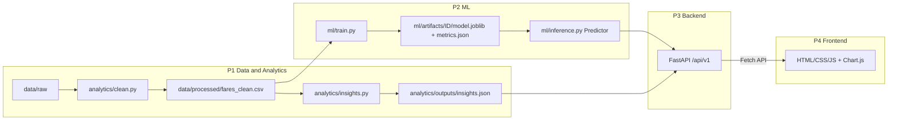

# FareLens: Project Handbook (the "Bible")

> **Official title:** Airfare Price Estimation and Fare Pattern Analysis
> **Working codename:** **FareLens**, an honest airfare estimator (prediction + uncertainty + staleness warnings)
> **Category:** Web Development | **Stack:** JavaScript, ML (Python/FastAPI) | **Mentor:** Arti Budhiraja
> **Team size:** 4 | **Code editor/agent:** Antigravity

If you have a doubt, search this file first, then `docs/CONTRACTS.md`, then your role file in `docs/roles/`. If it is still unclear, ask the team (and record the answer in `docs/DECISIONS.md`).

---

## 0. Read this first: fix before submission

The project brief header says **"Solar Power Generation Prediction and Performance Deviation Analysis"** but the Title and Problem Statement are about **Airfare Price Estimation and Fare Pattern Analysis**. Everything in this repo follows the airfare title. **Confirm with the mentor/portal that the header is a typo** so the submission does not carry the wrong title.

---

## 1. Problem statement, decoded

> Estimate airfare from route, airline, journey-date, duration, stop-count, and booking-related attributes. Compare regression algorithms, engineer date and categorical features, and analyze factors associated with higher fares. Evaluate on held-out records and explain how collection dates and market changes limit current-price predictions.

Every clause is a graded deliverable. This is the **traceability matrix**; the demo and report must visibly hit every row.

| # | PS clause | What we build | Owner | Acceptance test |
|---|-----------|---------------|-------|-----------------|
| R1 | Estimate airfare from route, airline, journey-date, duration, stop-count, booking-related attributes | Prediction form + `POST /api/v1/predict` | P3 + P4 (model by P2) | User enters all listed inputs and gets a price in INR |
| R2 | Compare regression algorithms | **Model Arena**: 7+ models, same split, 5-fold CV, tuned, leaderboard in UI | P2 (UI by P4) | Leaderboard table with MAE/RMSE/R²/MAPE/train-time for every model |
| R3 | Engineer date features | Day-of-week, month, weekend, cyclical encodings, holiday/festival proximity, time-of-day buckets, duration in minutes | P2 (holiday file by P1) | Feature ablation table shows effect of engineered features |
| R4 | Engineer categorical features | Rare-category grouping, route key, one-hot vs target/ordinal encoding comparison, airline tier | P2 | Documented encoder comparison on the same split |
| R5 | Analyze factors associated with higher fares | EDA + permutation importance + SHAP + partial-dependence; "associated", never "causes" | P1 (EDA), P2 (importance) | Insights page with ranked factors and plain-English notes |
| R6 | Evaluate on held-out records | Fixed-seed test set never touched during tuning; MAE, RMSE, R², MAPE; residual & segment error analysis | P2 | `ml/artifacts/<id>/metrics.json` + residual plots |
| R7 | Explain how collection dates and market changes limit current-price predictions | **Temporal drift experiment**, **staleness banner** on every prediction, **market-shift what-if slider**, dedicated Limitations page | P1 (data window), P2 (experiment), P3 (staleness logic), P4 (UI) | Drift chart (random vs time-based split error), banner visible on every result |

---

## 2. How we stand out (specificity + innovation)

Most student airfare projects: load Kaggle CSV, fit Linear/RF, print R², build a form. We differentiate on **honesty, explainability and decision support**.

1. **Uncertainty-first predictions.** Every price comes with an 80% prediction interval (split conformal prediction) and we report *empirical coverage* on the test set. Shows statistical maturity.
2. **Staleness-aware.** The training data covers a fixed collection window. We show a staleness level (Fresh / Aging / Stale / Out-of-range) on every prediction. This directly answers the last sentence of the PS.
3. **Temporal drift experiment.** Compare random-split performance vs train-on-early / test-on-late performance. The gap quantifies how much "market change" hurts. Most teams never do this.
4. **"Why this price?"** Per-prediction top factors (SHAP or permutation-based) in plain English ("Departing 06:00 on a Friday raised the estimate by about ₹X").
5. **Deal Score.** Compare the estimate with the route's historical median/percentile: Cheap / Typical / Expensive.
6. **Cheapest-date finder (what-if).** Re-predict across ±7 days around the chosen date and chart it. *Caveat shown in UI: model learned patterns from historical samples, not a live fare feed.*
7. **Model Arena with a switcher.** Users can choose which trained model answers (Linear, Ridge, Tree, RF, Gradient Boosting, XGBoost/LightGBM, optional stack).
8. **Engineering ablation.** Quantified proof that date/categorical feature engineering helps (with and without).
9. **Segment error analysis.** Where is the model weakest (airline, route, price band)? Reported honestly.
10. **Batch CSV prediction + export** for power users; **Postman collection** and **OpenAPI docs** for the API.
11. **Data-leakage discipline.** De-duplicate before splitting, fit encoders on train only, pipeline stored inside the model artifact.
12. **Reproducibility.** One command each for data prep, training, serving, and UI; versioned model registry with metrics.

> **Language rule (important for viva):** we say fares are *associated with* factors, not *caused by* them. We say *estimate*, never *the price*.

---

## 3. Architecture



**Four hard seams (interfaces)**, each defined in `docs/CONTRACTS.md`, so nobody blocks anybody:

| Seam | Producer → Consumer | Contract | Fallback until real thing exists |
|------|--------------------|----------|----------------------------------|
| S1 | P1 → P2 | Clean CSV schema | `data/sample/sample_fares.csv` (P1 commits within 24h) |
| S2 | P2 → P3 | `ml/inference.py` `Predictor` interface | `StubPredictor` in `backend/app/stub_predictor.py` |
| S3 | P3 → P4 | REST API + JSON shapes | `frontend/mocks/*.json` + mock mode toggle |
| S4 | P1 → P3 → P4 | `insights.json` schema | `analytics/outputs/insights.sample.json` |

---

## 4. Tech stack and decisions

| Layer | Choice | Why |
|-------|--------|-----|
| Language (ML/API) | Python 3.11 | scikit-learn ecosystem |
| Data | pandas, numpy | standard |
| ML | scikit-learn (Linear, Ridge/Lasso, DecisionTree, RandomForest, HistGradientBoosting), optional XGBoost/LightGBM | README promises Linear/Tree/RF + extras |
| Explainability | `shap` (optional), `sklearn.inspection` (permutation importance, PDP) | fallback if SHAP is heavy |
| Plots (offline) | matplotlib, seaborn | already in README |
| API | FastAPI + Pydantic v2 + Uvicorn | typed contracts, free Swagger docs |
| API testing | Postman collection + pytest | both allowed by brief |
| Frontend | Vanilla JS (ES modules) + HTML + CSS + Chart.js, **Fetch API** | matches "HTML, CSS, JavaScript"; no build step; easiest for Antigravity |
| Packaging | `requirements/*.txt`, optional Dockerfile | reproducible |
| Deploy (stretch) | Render/Railway (API), GitHub Pages/Netlify (UI) | free tiers |

Any change goes into `docs/DECISIONS.md` (date, decision, reason, who).

---

## 5. Data plan

### 5.1 Dataset strategy
We have not inspected the data in this repo yet, so **P1 must verify every column name below after download**. These are the commonly documented layouts.

| Role in project | Dataset (Kaggle, search by name) | Typical columns | Why |
|----------------|----------------------------------|-----------------|-----|
| **Primary** | Indian "Flight Fare Prediction" (`Data_Train`, ~10.7k rows, 2019 journeys) | Airline, Date_of_Journey, Source, Destination, Route, Dep_Time, Arrival_Time, Duration, Total_Stops, Additional_Info, Price | Has journey date + duration + stops + booking-related field (`Additional_Info`): matches the PS wording |
| **Secondary (optional, strongly recommended)** | "Flight Price Prediction" (EaseMyTrip, ~300k rows, ~2022) | airline, flight, source_city, departure_time, stops, arrival_time, destination_city, class, duration, days_left, price | Gives `days_left` (booking window) and scale; supports booking-window and cross-collection drift analysis |

Known quirks to handle (verify): city spelling variants (e.g. "Banglore"), "Delhi" vs "New Delhi", a missing Route/Total_Stops row, duplicate rows, rare airlines with 1 or 2 rows, extreme business-class outliers, duration stored as text ("2h 50m").

Prices are in **INR**. Keep currency explicit everywhere.

### 5.2 Canonical schema
Defined in `docs/CONTRACTS.md` §1. Both datasets are mapped into it. Fields not available in a dataset are `null`.

### 5.3 Data rules
- Raw data is **never committed** (see `.gitignore`); commit only `data/sample/` (≤ 1000 rows) and small processed outputs.
- De-duplicate **before** any split.
- Document every cleaning step with counts removed/changed (`reports/data_quality_report.md`).
- Record the **collection window** (min/max journey date, source, download date) in `data/DATASET_CARD.md`. This feeds the staleness feature.

---

## 6. ML plan (summary; details in `docs/roles/ROLE_2_ML_ENGINEER.md`)

- **Target:** `price_inr`, modeled as `log1p(price)` (skewed), reported back in INR.
- **Splits:** fixed seed (`42`): 70% train / 10% calibration / 20% test (random). Plus **time-based split** (train earlier journey months, test the latest) for the drift experiment.
- **Models (Arena):** Linear Regression (baseline), Ridge, Lasso/ElasticNet, Decision Tree, Random Forest, HistGradientBoosting, XGBoost or LightGBM (optional), Stacking (stretch).
- **Tuning:** `RandomizedSearchCV`, 5-fold CV on train only.
- **Metrics:** MAE, RMSE, R², MAPE (all in INR), plus train time and model size.
- **Intervals:** split conformal (80%) with measured coverage on test.
- **Explainability:** permutation importance (global), SHAP (global + local, optional), PDP for top features.
- **Artifacts:** one folder per model under `ml/artifacts/`, one `registry.json`.
- **Size guard:** each `model.joblib` must be **< 50 MB** (GitHub limit is 100 MB per file). Limit forest depth/trees, use `compress=3`.

---

## 7. Feature backlog (add multiple features, prioritized)

Tier **A = must (covers the PS)**, **B = should (makes us stand out)**, **C = wow (if time)**, **D = stretch**. Effort: S ≤ 0.5d, M ≈ 1-2d, L ≈ 3-5d.

| ID | Feature | Tier | Owner | Effort | Notes |
|----|---------|------|-------|--------|-------|
| F-01 | Prediction form (airline, source, destination, date, dep time, duration, stops, additional info) | A | P4 | M | Validated inputs, date picker |
| F-02 | `POST /predict` | A | P3 | M | Contract §3 |
| F-03 | Model Arena leaderboard | A | P2 / P4 | M | Table + bar chart |
| F-04 | EDA dashboards (price by airline, stops, month, day-of-week, route heatmap) | A | P1 / P4 | M | From `insights.json` |
| F-05 | Held-out evaluation + residual plots | A | P2 | M | metrics.json |
| F-06 | Feature importance page | A | P2 / P4 | M | Permutation + SHAP |
| F-07 | Limitations page (collection dates, market change) | A | P1 / P4 | S | Mandatory for R7 |
| F-08 | 80% prediction interval + coverage report | B | P2 / P3 | M | Conformal |
| F-09 | Staleness banner/level on every prediction | B | P3 / P4 | S | Contract §3.2 |
| F-10 | Temporal drift experiment + chart | B | P2 / P1 | M | Random vs time split |
| F-11 | "Why this price?" local explanation | B | P2 / P4 | M | Top 5 factors |
| F-12 | Deal Score (Cheap/Typical/Expensive) | B | P1 / P3 | S | Route percentile |
| F-13 | Cheapest-date what-if (±7 days) | B | P3 / P4 | M | Calls predictor in a loop |
| F-14 | Model switcher in UI | B | P3 / P4 | S | `model_id` param |
| F-15 | Feature-engineering ablation table | B | P2 | S | Same split, with/without |
| F-16 | Segment error analysis (airline/route/price band) | B | P2 / P1 | M | Honest weak spots |
| F-17 | Route and airline compare tool | B | P4 / P3 | M | Side-by-side estimates |
| F-18 | Market-shift slider (what-if inflation ±%) | C | P4 / P3 | S | Clearly labeled as an *assumption*, not a forecast |
| F-19 | Batch CSV upload + download results | C | P3 / P4 | M | Pydantic row validation |
| F-20 | Out-of-distribution warnings (unseen route/airline/date) | C | P3 | S | Part of `warnings[]` |
| F-21 | Booking-window curve (`days_left` vs price) from secondary dataset | C | P1 / P4 | M | Cross-sectional; say so |
| F-22 | Saved searches/history (localStorage) | C | P4 | S | No server state |
| F-23 | Dark mode + responsive + a11y (keyboard, labels, contrast) | C | P4 | S | Lighthouse ≥ 90 a11y |
| F-24 | Postman collection + environment + tests | A | P3 | S | In `postman/` |
| F-25 | CI (GitHub Actions: lint + pytest) | C | P3 | S | |
| F-26 | Dockerfile + deploy | D | P3 | M | |
| F-27 | Stacking ensemble | D | P2 | M | |
| F-28 | Live-fare "reality check" adapter (mocked unless a free API is verified available) | D | P3 | L | Never claim live accuracy |
| F-29 | PDF/PNG export of a result card | D | P4 | S | |
| F-30 | Multilingual UI (EN + one more) | D | P4 | M | |

**Rule:** never start a C/D item until all A items for your role are merged and B items are in progress.

---

## 8. Repository layout and ownership

```
Airfare-Price-Estimation-and-Analysis/
├── AGENTS.md                      # short pointer for agents (copy of rules header)
├── README.md
├── .gitignore
├── .agent/rules/project-rules.md  # Antigravity workspace rules
├── docs/
│   ├── HANDBOOK.md                # this file
│   ├── CONTRACTS.md               # schemas + API contract (shared, PR needs all 4 approvals)
│   ├── DECISIONS.md               # decision log
│   └── roles/ROLE_1..4_*.md
├── data/        raw/ (git-ignored)  interim/  processed/  sample/  external/   # P1
├── analytics/   clean.py  insights.py  outputs/                                 # P1
├── notebooks/   01_ (P1) 02_ (P1) 03_.. (P2)
├── ml/          features.py train.py evaluate.py inference.py artifacts/        # P2
├── backend/     app/ tests/  Dockerfile                                         # P3
├── postman/                                                                     # P3
├── frontend/    index.html pages/ js/ css/ mocks/                               # P4
├── reports/     figures/ data_quality_report.md final_report.md                 # shared
├── requirements/ data.txt ml.txt api.txt  + requirements.txt (-r each)
└── scripts/     run_api.sh run_ui.sh make_sample.py
```

| Directory | Owner | Others may |
|-----------|-------|------------|
| `data/`, `analytics/` | P1 | read |
| `ml/` | P2 | read, import `ml.inference` only |
| `backend/`, `postman/`, CI | P3 | read |
| `frontend/` | P4 | read |
| `docs/CONTRACTS.md` | all | edit only via PR with all 4 approvals |
| `docs/roles/*` | owner of that role | read |

---

## 9. Team roles at a glance

| | P1 Data and Analytics | P2 ML Engineer | P3 Backend/API | P4 Frontend and UX |
|---|---|---|---|---|
| File | `ROLE_1_DATA_ANALYTICS.md` | `ROLE_2_ML_ENGINEER.md` | `ROLE_3_BACKEND_API.md` | `ROLE_4_FRONTEND_UX.md` |
| Languages | Python | Python | Python | JavaScript |
| Ships | clean data, sample, EDA, insights.json, dataset card | features, Arena, metrics, drift, `inference.py` | FastAPI, Postman, tests, deploy | UI pages, charts, mock mode, demo |
| Needs from others | nothing | clean CSV (has sample fallback) | `inference.py` (has stub) | API (has mocks) |
| Report chapters | Data, EDA, Limitations | Methods, Results | System design, API | UI/UX, Demo, Conclusion |

Dependency design: **contracts first, stubs second, integration third.** Nobody waits for anybody; everybody integrates on fixed milestone days.

---

## 10. Timeline (adjust to your real deadline)

Assumes ~6 weeks. Compress proportionally if shorter.

| Phase | Time | Goal | Exit check |
|-------|------|------|-----------|
| 0 Kickoff | Day 1 | Read handbook, freeze CONTRACTS.md, create repo skeleton, branches, requirements | Everyone can run `python -V`, `uvicorn`, open `frontend/index.html` |
| 1 Parallel foundations | Week 1 | P1 sample + clean pipeline; P2 baseline on sample; P3 stub API; P4 UI shell on mocks | All four demo their piece standalone |
| **M1 Walking skeleton** | End Week 2 | Real clean data → baseline model → API → UI prediction end-to-end | Form returns a real model price |
| 2 Core (Tier A) | Weeks 2-3 | Arena, EDA pages, metrics, Limitations page, Postman | All Tier A merged |
| **M2 Feature complete B** | End Week 4 | Intervals, staleness, drift, explanations, deal score, what-if | B items merged |
| 3 Wow and polish | Week 5 | Tier C, responsive/a11y, tests, CI, deploy attempt | Lighthouse, pytest green |
| **M3 Freeze** | Start Week 6 | Feature freeze; bug fixes only; report; slides; rehearsal | Tagged `v1.0` |

Integration days (M1, M2, M3) are **whole-team sessions** (no one works alone that day).

---

## 11. Git and collaboration rules

- Branches: `main` (protected, always runnable) ← PRs from `feat/<role>-<topic>` (e.g. `feat/ml-conformal`, `feat/ui-leaderboard`). Never push to `main` directly.
- One PR = one purpose, ≤ ~400 changed lines, link the feature ID (e.g. "F-08").
- PR review: 1 reviewer from a **different** role (cross-learning), 2 for `CONTRACTS.md` (all 4).
- Commits: Conventional style: `feat(ml): add conformal intervals (F-08)`.
- Daily 10-minute standup in chat: Yesterday / Today / Blocked.
- Never commit: raw data, `.env`, models > 50 MB, notebooks with huge outputs (clear outputs first).
- Rebase on `main` before opening a PR.

**Definition of Done (any task):** code runs from a clean clone using documented commands; has at least a basic test or a manual test note; no TODOs left silently; docs updated; PR merged; feature ID ticked in the checklist of your role file.

---

## 12. Testing and quality

| Level | Who | What |
|-------|-----|------|
| Data tests | P1 | no nulls in required columns, price > 0, date parseable, duplicates removed, schema match |
| ML tests | P2 | pipeline fits/predicts on sample; no leakage test (encoders fit on train); reproducible seed; artifact loads |
| API tests | P3 | pytest for each endpoint, Postman collection runs green, validation errors return the standard error shape |
| UI tests | P4 | manual checklist + mock mode + Lighthouse; test empty/error/loading states |
| E2E | all | M1/M2/M3 scripted walkthrough (`docs/DEMO_SCRIPT.md`, created by P4 in week 5) |

---

## 13. Limitations statement (use this wording in app, report, and viva)

> This tool estimates fares from **historical data collected over a fixed window** (see Dataset Card). Airfares move with demand, seasonality, fuel costs, competition, promotions and booking time. Because our model has never seen **today's** market, its estimates can be systematically off for current dates. We quantify this with a temporal drift experiment (error rises when testing on later periods than training) and show a staleness level with every estimate. Intervals reflect uncertainty *within the training distribution* and may under-cover when the market shifts. Estimates are for pattern exploration, not for purchase decisions.

---

## 14. Risks and mitigations

| Risk | Likelihood | Mitigation |
|------|-----------|------------|
| Dataset columns differ from assumptions | Med | P1 verifies on Day 1, updates CONTRACTS via PR |
| Model file too large for GitHub | Med | Size guard, `compress=3`, limit trees, release artifact instead of commit |
| One member blocked/absent | Med | Stubs/mocks, pairing: P1↔P2, P3↔P4 as backups |
| Scope creep | High | Tier rule in §7 |
| Data leakage inflating R² | High | Dedupe first, split first, fit-on-train-only, reviewer checks |
| Over-claiming accuracy | High | Language rule in §2, Limitations page |
| Time lost on deployment | Med | Local demo is primary; deploy is Tier D |
| Antigravity changes files outside the role | Med | `.agent/rules/project-rules.md` ownership rules, review diffs |

---

## 15. Viva / mentor Q&A cheat sheet

- **Why log-transform price?** Right-skewed; stabilizes variance; we back-transform to INR for metrics.
- **Why is R² high but we still warn?** R² is in-distribution; temporal split shows degradation.
- **Why Random Forest vs Linear?** Non-linear interactions (airline × route × stops × date); Arena shows evidence.
- **How do you prevent leakage?** Dedupe before splitting; pipeline inside CV; encoders fit on train only; test set touched once.
- **What do intervals mean?** ~80% of true fares should fall inside; we measured coverage = X% on test.
- **Is feature importance causal?** No. Associational only.
- **Can it predict today's price?** Not reliably; see Limitations + drift experiment.
- **Why vanilla JS?** Brief requires JavaScript + Fetch API; no build tool risk.
- **What if the API is down?** UI shows a clear error state; mock mode for demos.

---

## 16. Glossary

**MAE** mean absolute error. **RMSE** root mean squared error. **R²** variance explained. **MAPE** mean absolute % error. **Conformal prediction** method giving intervals with a coverage guarantee under exchangeability. **Drift** change in data/market over time that degrades a model. **Leakage** test information leaking into training. **Staleness** age of training data relative to the query date. **SHAP** per-prediction feature attribution. **PDP** partial dependence plot.

---

## 17. Deliverables checklist for submission

- [ ] Public repo, tagged `v1.0`
- [ ] README with 5-command quickstart and screenshots
- [ ] Working UI + API (local), optional deployed link
- [ ] `reports/final_report.md` (or PDF) with all chapters
- [ ] Model Arena results table + drift chart + coverage number
- [ ] Postman collection exported
- [ ] Demo video/slides (P4)
- [ ] Limitations page live in the app
